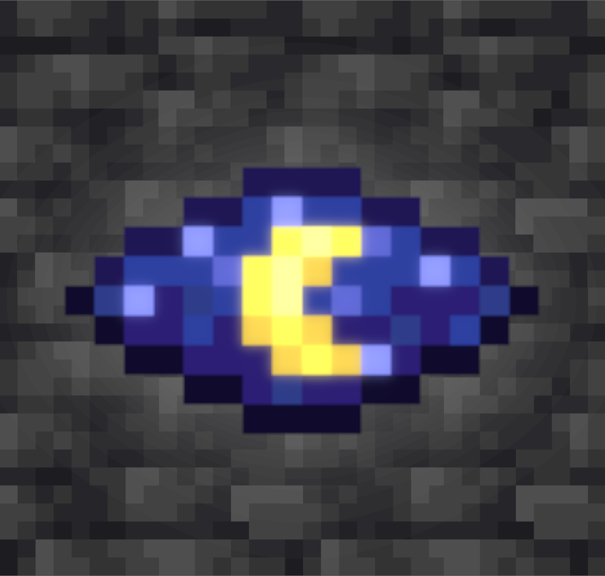
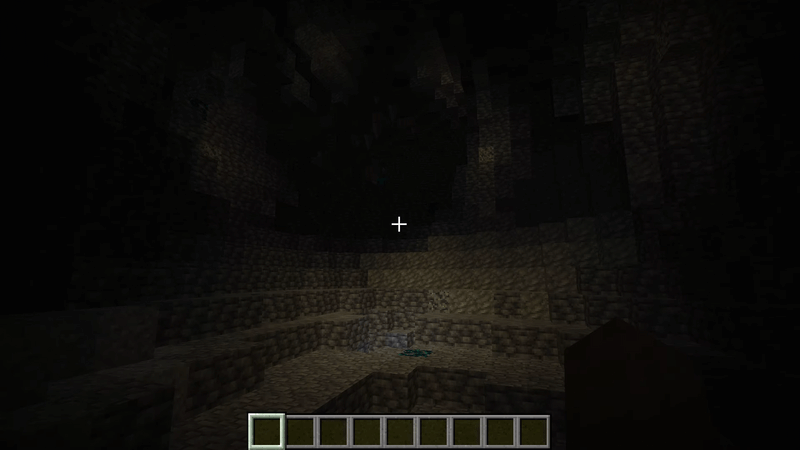

<p align="center">
  
</p>

<h1 align="center">/NightVision</h1>

<a href="https://market.pumpkinmc.org/plugin/116" title="PumpkinMC: Marketplace">
  
</a>

An incredibly lightweight PumpkinMC plugin to toggle night vision for the player.

<div align="center">
    
</div>

## Permissions

### `slashnv:nv`

Allows executing the night vision command

## Commands

`/nv` `/nightvision`

## Prerequisites

### [PumpkinMC API for C](https://github.com/Pumpkin-MC/pumpkin-api-c/releases/)

Configure the directory in [build.sh](/build.sh)

### [wasi-sdk](https://github.com/WebAssembly/wasi-sdk/releases/tag/wasi-sdk-34)

Should be in your path, or configure build.sh to it's path

## Building

Simply run build.sh or run:

```shell
/path/to/wasi-sdk/bin/wasm32-wasip2-clang -Oz \
    -Ipumpkin-api/include \
    pumpkin-api/lib/libpumpkin-api.a \
    main.c \
    -o my_plugin.wasm \
    -mexec-model=reactor
```

---------
**Made with ❤️ by yousif51811 (Zerorifter)**
